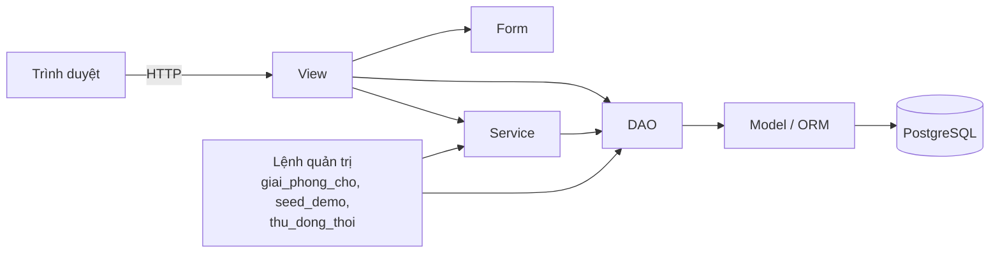
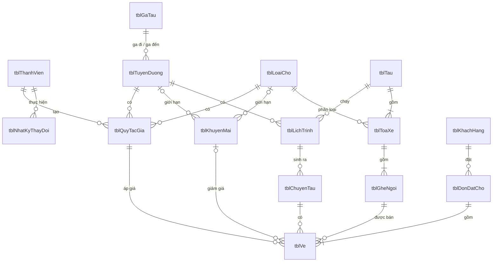
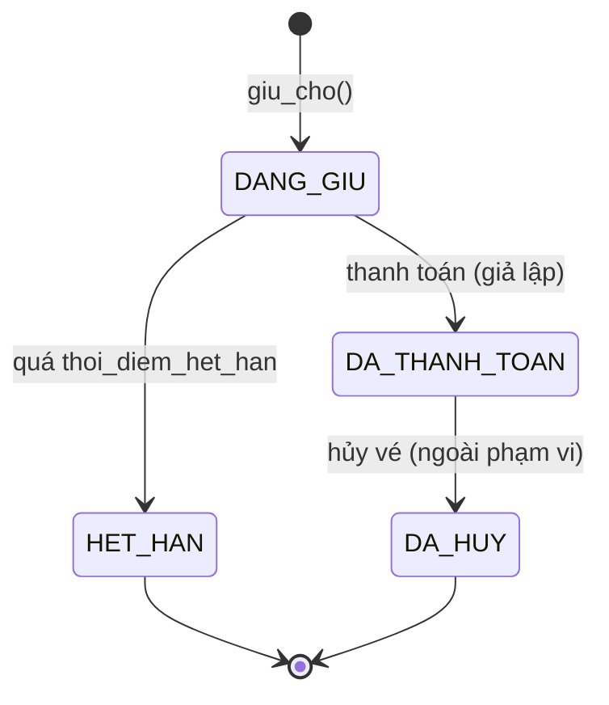
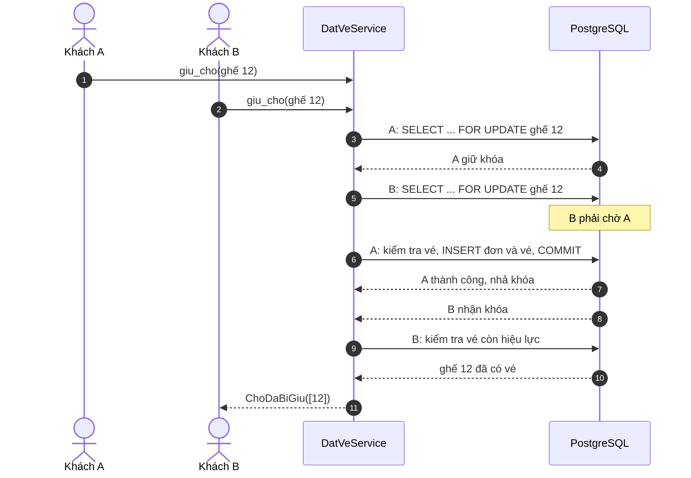

# Tài liệu thiết kế hệ thống thử nghiệm – Quản lý bán vé tàu

Người thực hiện: Trịnh Hoàng Hiếu – K23DTCN353
Học phần: Phân tích thiết kế hệ thống thông tin
Phiên bản: 1.0 – 21/10/2026
Tài liệu gốc: `BaoCao_PTTK_TrinhHoangHieu_K23DTCN353.docx` (gọi tắt là "báo cáo")

Tài liệu này chuyển kết quả phân tích thiết kế trong báo cáo thành bản thiết kế đủ chi tiết để lập trình một hệ thống thử nghiệm (demo) chạy được trên máy cá nhân. Hệ thống demo cài đặt hai use case đã được phân tích chi tiết: UC14 – Quản lý giá vé và khuyến mãi, và UC02 – Đặt vé (giữ chỗ). Tên lớp, tên bảng, tên phương thức giữ nguyên như trong báo cáo để người chấm có thể đối chiếu giữa báo cáo và mã nguồn. Những chỗ tài liệu này điều chỉnh so với báo cáo đều được liệt kê ở mục 12.

---

## 1. Mục tiêu và phạm vi của bản demo

### 1.1. Mục tiêu

Bản demo cần chứng minh được ba điều trong một buổi trình bày khoảng 10 phút. Thứ nhất, Quản lý thiết lập được giá vé và khuyến mãi, và hệ thống chặn được các trường hợp sai nghiệp vụ (giá âm, trùng thời gian áp dụng, sửa quy tắc đã dùng). Thứ hai, khách hàng tìm được chuyến, chọn chỗ trên sơ đồ toa, nhập thông tin hành khách và giữ chỗ thành công với giá được tính đúng theo quy tắc giá và khuyến mãi. Thứ ba, khi hai người cùng giữ một chỗ thì chỉ một người thành công, và chỗ được giải phóng khi hết thời gian giữ.

### 1.2. Phạm vi

| Thuộc phạm vi demo | Ngoài phạm vi demo |
|---|---|
| UC14 đầy đủ các luồng chính A, B và luồng rẽ nhánh E1–E5 | UC03 Thanh toán thật qua cổng thanh toán (chỉ có nút "Thanh toán giả lập" để đổi trạng thái) |
| UC02 đầy đủ luồng chính 1–12 và luồng rẽ nhánh A1–A8 | UC04, UC09, UC10, UC12 (hủy vé, bán tại quầy, hoàn tiền) |
| UC06/UC07 Đăng nhập, đăng xuất (dùng Django auth) | REST API (Django REST Framework) |
| Dữ liệu danh mục nhập qua trang Django Admin và lệnh tạo dữ liệu mẫu | Redis, Celery, bộ nhớ đệm |
| Lệnh giải phóng chỗ hết hạn và lệnh thử đặt đồng thời | Gửi email/SMS thật (dùng console email backend) |

### 1.3. Giả định

Mỗi vé được bán cho cả tuyến (từ ga đi đến ga đến của tuyến), không bán theo chặng con, đúng như giả định ở mục 2.2.3.c của báo cáo. Khách hàng không cần tài khoản. Hệ thống chạy một tiến trình web trên máy của sinh viên, dùng PostgreSQL; số người dùng đồng thời chỉ vài người nên không cần tối ưu tải.

---

## 2. Công nghệ và môi trường

| Thành phần | Lựa chọn | Ghi chú |
|---|---|---|
| Ngôn ngữ | Python 3.12 | |
| Framework | Django 5.2 (LTS) | MVT, ORM, auth, admin, `transaction.atomic`, `select_for_update` |
| CSDL | PostgreSQL 16 | Bắt buộc. Demo cần khóa hàng thật và ràng buộc `EXCLUDE`; SQLite không đáp ứng được |
| Driver | psycopg 3 (`psycopg[binary]`) | |
| Giao diện | Django Templates + Bootstrap 5.3 (CDN) + JavaScript thuần | Không dùng framework front-end |
| Kiểm thử | pytest, pytest-django | |
| Chạy CSDL | Docker Desktop (`docker compose`) hoặc PostgreSQL cài trực tiếp trên Windows | |

`requirements.txt`:

```text
Django>=5.2,<5.3
psycopg[binary]>=3.2
python-dotenv>=1.0
pytest>=8.0
pytest-django>=4.8
```

`docker-compose.yml` (chỉ chạy CSDL, ứng dụng chạy trực tiếp bằng `runserver`):

```yaml
services:
  db:
    image: postgres:16
    environment:
      POSTGRES_DB: quanlyvetau
      POSTGRES_USER: qlvt
      POSTGRES_PASSWORD: qlvt
    ports:
      - "5432:5432"
    volumes:
      - pgdata:/var/lib/postgresql/data
volumes:
  pgdata: {}
```

`.env.example`:

```text
DB_NAME=quanlyvetau
DB_USER=qlvt
DB_PASSWORD=qlvt
DB_HOST=localhost
DB_PORT=5432
GIU_CHO_PHUT=15
MAX_CHO_MOI_DON=6
NGUNG_BAN_TRUOC_PHUT=60
```

Khi trình bày, có thể đặt `GIU_CHO_PHUT=1` để chứng minh việc tự giải phóng chỗ mà không phải chờ lâu.

---

## 3. Kiến trúc tổng thể

Hệ thống demo là một ứng dụng Django nguyên khối (monolith) chia thành bốn ứng dụng con theo nghiệp vụ. Bên trong mỗi ứng dụng, mã nguồn được chia tầng đúng như biểu đồ lớp pha thiết kế trong báo cáo: View nhận yêu cầu và hiển thị template; Form kiểm tra dữ liệu nhập; Service chứa nghiệp vụ nhiều bước; DAO là nơi duy nhất được truy vấn CSDL; Model (lớp thực thể) mô tả dữ liệu.



Quy tắc phụ thuộc giữa các tầng được giữ cố định để mã dễ đọc và dễ kiểm thử: View không viết truy vấn ORM trực tiếp mà gọi DAO hoặc Service; Service không đọc `request`; DAO không chứa quy tắc nghiệp vụ ngoài việc lọc dữ liệu; Template không gọi phương thức có ghi CSDL.

| Ứng dụng | Nội dung | Tương ứng trong báo cáo |
|---|---|---|
| `taikhoan` | `ThanhVien` (người dùng nội bộ), `QuanLy` (proxy), mixin phân quyền | Tác nhân Thành viên hệ thống, Quản lý |
| `danhmuc` | `GaTau`, `TuyenDuong`, `LoaiCho`, `Tau`, `ToaXe`, `GheNgoi`, `LichTrinh`, `ChuyenTau` và các DAO đọc danh mục | Các bảng danh mục, mục 2.2.2.e và 2.2.3.e |
| `giave` | `QuyTacGia`, `KhuyenMai`, `NhatKyThayDoi`, View/Form/DAO của UC14 | Mục 2.2.2 |
| `datve` | `KhachHang`, `DonDatCho`, `Ve`, `DatVeService`, `TinhGiaService`, `GiaiPhongChoTask`, View/Form/DAO của UC02 | Mục 2.2.3 |

---

## 4. Cấu trúc thư mục mã nguồn

Mã nguồn đặt trong thư mục `QuanLyVeTau` cùng với báo cáo:

```text
QuanLyVeTau/
├── BaoCao_PTTK_TrinhHoangHieu_K23DTCN353.docx
├── THIET_KE_HE_THONG_DEMO.md
├── docker-compose.yml
├── requirements.txt
├── .env.example
├── pytest.ini
├── manage.py
├── quanlyvetau/                 # cấu hình dự án
│   ├── settings.py
│   └── urls.py
├── taikhoan/
│   ├── models.py                # ThanhVien, QuanLy
│   ├── mixins.py                # VaiTroRequiredMixin
│   └── admin.py
├── danhmuc/
│   ├── models.py
│   ├── dao.py                   # GaTauDAO, TuyenDuongDAO, LoaiChoDAO, ChuyenTauDAO, GheNgoiDAO
│   ├── admin.py
│   └── management/commands/seed_demo.py
├── giave/
│   ├── models.py                # QuyTacGia, KhuyenMai, NhatKyThayDoi
│   ├── dao.py                   # QuyTacGiaDAO, KhuyenMaiDAO, NhatKyDAO
│   ├── forms.py                 # QuyTacGiaForm, KhuyenMaiForm
│   ├── views.py                 # QuanLyGiaVeView, QuyTacGiaView, NgungApDungView, KhuyenMaiView, KetThucKhuyenMaiView
│   ├── urls.py
│   └── migrations/0002_exclusion_constraint.py
├── datve/
│   ├── models.py                # KhachHang, DonDatCho, Ve
│   ├── dao.py                   # KhachHangDAO, DonDatChoDAO
│   ├── exceptions.py            # ChoDaBiGiu, KhongCoGia, ChuyenKhongMoBan, KhuyenMaiHetLuot
│   ├── services.py              # TinhGiaService, DatVeService
│   ├── tasks.py                 # GiaiPhongChoTask
│   ├── forms.py                 # ThongTinDatVeForm, HanhKhachFormSet
│   ├── views.py                 # TimChuyenView, ChonChoView, ThongTinHanhKhachView, GiuChoView, KetQuaGiuChoView, ThanhToanGiaLapView
│   ├── urls.py
│   └── management/commands/
│       ├── giai_phong_cho.py
│       └── thu_dong_thoi.py
├── templates/
│   ├── base.html
│   ├── registration/login.html
│   ├── quan_ly/
│   │   ├── gd_quan_ly_gia_ve.html
│   │   ├── gd_quy_tac_gia.html
│   │   ├── gd_khuyen_mai.html
│   │   └── gd_xac_nhan.html
│   └── dat_ve/
│       ├── gd_tim_chuyen.html
│       ├── gd_chon_cho.html
│       ├── gd_thong_tin_hanh_khach.html
│       └── gd_ket_qua_giu_cho.html
└── tests/
    ├── test_tinh_gia.py
    ├── test_quy_tac_gia.py
    ├── test_khuyen_mai.py
    ├── test_giu_cho.py
    └── test_dong_thoi.py
```

---

## 5. Thiết kế dữ liệu

### 5.1. Sơ đồ quan hệ

Sơ đồ dưới đây gộp hai sơ đồ CSDL của UC14 và UC02 trong báo cáo (Hình 2.6 và Hình 2.14) thành một sơ đồ chung.



### 5.2. Model Django

Toàn bộ model dùng `db_table` để tên bảng trùng với báo cáo. Khóa ngoại dùng tên trường không có hậu tố `_id` (Django tự sinh cột `..._id`), nhờ đó tên cột trong CSDL cũng trùng với báo cáo. Tiền tệ dùng `DecimalField(max_digits=12, decimal_places=0)` (đơn vị đồng).

`ThanhVien` phải là custom user model và phải được khai báo trước lần `migrate` đầu tiên (`AUTH_USER_MODEL = "taikhoan.ThanhVien"`), nếu không sẽ phải xóa CSDL làm lại.

```python
# taikhoan/models.py
from django.contrib.auth.models import AbstractUser, UserManager
from django.db import models


class ThanhVien(AbstractUser):
    class VaiTro(models.TextChoices):
        NHAN_VIEN_BAN_VE = "NHAN_VIEN_BAN_VE", "Nhân viên bán vé"
        QUAN_LY = "QUAN_LY", "Quản lý"
        QUAN_TRI = "QUAN_TRI", "Quản trị hệ thống"

    username = models.CharField("Tên đăng nhập", max_length=50, unique=True, db_column="ten_dang_nhap")
    password = models.CharField("Mật khẩu", max_length=128, db_column="mat_khau")
    first_name = None
    last_name = None
    ho_ten = models.CharField("Họ tên", max_length=100)
    vai_tro = models.CharField(max_length=20, choices=VaiTro.choices, default=VaiTro.NHAN_VIEN_BAN_VE)

    class Meta:
        db_table = "tblThanhVien"


class QuanLyManager(UserManager):
    def get_queryset(self):
        return super().get_queryset().filter(vai_tro=ThanhVien.VaiTro.QUAN_LY)


class QuanLy(ThanhVien):
    """Lớp QuanLy kế thừa ThanhVien như trong báo cáo; dùng chung bảng tblThanhVien."""
    objects = QuanLyManager()

    class Meta:
        proxy = True
```

```python
# danhmuc/models.py
from django.db import models


class GaTau(models.Model):
    ten_ga = models.CharField(max_length=100)
    tinh_thanh = models.CharField(max_length=100, blank=True)

    class Meta:
        db_table = "tblGaTau"


class TuyenDuong(models.Model):
    ma_tuyen = models.CharField(max_length=20, unique=True)
    ten_tuyen = models.CharField(max_length=150)
    ga_di = models.ForeignKey(GaTau, on_delete=models.PROTECT, related_name="tuyen_di")
    ga_den = models.ForeignKey(GaTau, on_delete=models.PROTECT, related_name="tuyen_den")

    class Meta:
        db_table = "tblTuyenDuong"


class LoaiCho(models.Model):
    ma_loai = models.CharField(max_length=10, unique=True)
    ten_loai = models.CharField(max_length=100)
    mo_ta = models.CharField(max_length=255, blank=True)

    class Meta:
        db_table = "tblLoaiCho"


class Tau(models.Model):
    ma_tau = models.CharField(max_length=10, unique=True)
    ten_tau = models.CharField(max_length=100)

    class Meta:
        db_table = "tblTau"


class ToaXe(models.Model):
    tau = models.ForeignKey(Tau, on_delete=models.CASCADE, related_name="ds_toa")
    so_toa = models.PositiveSmallIntegerField()
    loai_cho = models.ForeignKey(LoaiCho, on_delete=models.PROTECT)

    class Meta:
        db_table = "tblToaXe"
        constraints = [models.UniqueConstraint(fields=["tau", "so_toa"], name="uq_toa_trong_tau")]


class GheNgoi(models.Model):
    toa_xe = models.ForeignKey(ToaXe, on_delete=models.CASCADE, related_name="ds_ghe")
    so_ghe = models.CharField(max_length=5)

    class Meta:
        db_table = "tblGheNgoi"
        constraints = [models.UniqueConstraint(fields=["toa_xe", "so_ghe"], name="uq_ghe_trong_toa")]


class LichTrinh(models.Model):
    tuyen_duong = models.ForeignKey(TuyenDuong, on_delete=models.PROTECT)
    tau = models.ForeignKey(Tau, on_delete=models.PROTECT)
    gio_khoi_hanh = models.TimeField()
    thoi_gian_chay = models.PositiveIntegerField(help_text="Số phút")

    class Meta:
        db_table = "tblLichTrinh"


class ChuyenTau(models.Model):
    class TrangThai(models.TextChoices):
        MO_BAN = "MO_BAN", "Mở bán"
        NGUNG_BAN = "NGUNG_BAN", "Ngừng bán"
        DA_CHAY = "DA_CHAY", "Đã chạy"

    lich_trinh = models.ForeignKey(LichTrinh, on_delete=models.PROTECT)
    ngay_khoi_hanh = models.DateField()
    trang_thai = models.CharField(max_length=20, choices=TrangThai.choices, default=TrangThai.MO_BAN)

    class Meta:
        db_table = "tblChuyenTau"
        constraints = [models.UniqueConstraint(fields=["lich_trinh", "ngay_khoi_hanh"], name="uq_chuyen_moi_ngay")]
```

```python
# giave/models.py
from django.conf import settings
from django.core.serializers.json import DjangoJSONEncoder
from django.db import models
from django.db.models import F, Q

from danhmuc.models import LoaiCho, TuyenDuong


class QuyTacGia(models.Model):
    class LoaiThoiDiem(models.TextChoices):
        NGAY_THUONG = "NGAY_THUONG", "Ngày thường"
        CUOI_TUAN = "CUOI_TUAN", "Cuối tuần"
        LE_TET = "LE_TET", "Lễ, Tết"

    class TrangThai(models.TextChoices):
        DANG_AP_DUNG = "DANG_AP_DUNG", "Đang áp dụng"
        NGUNG_AP_DUNG = "NGUNG_AP_DUNG", "Ngừng áp dụng"

    tuyen_duong = models.ForeignKey(TuyenDuong, on_delete=models.PROTECT)
    loai_cho = models.ForeignKey(LoaiCho, on_delete=models.PROTECT)
    gia_co_so = models.DecimalField(max_digits=12, decimal_places=0)
    loai_thoi_diem = models.CharField(max_length=20, choices=LoaiThoiDiem.choices)
    ngay_bat_dau = models.DateField()
    ngay_ket_thuc = models.DateField(null=True, blank=True)
    trang_thai = models.CharField(max_length=20, choices=TrangThai.choices, default=TrangThai.DANG_AP_DUNG)
    ghi_chu = models.CharField(max_length=255, blank=True)
    nguoi_tao = models.ForeignKey(settings.AUTH_USER_MODEL, on_delete=models.PROTECT)

    class Meta:
        db_table = "tblQuyTacGia"
        constraints = [
            models.CheckConstraint(condition=Q(gia_co_so__gt=0), name="ck_qtg_gia_duong"),
            models.CheckConstraint(
                condition=Q(ngay_ket_thuc__isnull=True) | Q(ngay_ket_thuc__gte=F("ngay_bat_dau")),
                name="ck_qtg_khoang_ngay",
            ),
        ]


class KhuyenMai(models.Model):
    class HinhThucGiam(models.TextChoices):
        PHAN_TRAM = "PHAN_TRAM", "Theo phần trăm"
        SO_TIEN = "SO_TIEN", "Theo số tiền"

    class TrangThai(models.TextChoices):
        SAP_AP_DUNG = "SAP_AP_DUNG", "Sắp áp dụng"
        DANG_AP_DUNG = "DANG_AP_DUNG", "Đang áp dụng"
        DA_KET_THUC = "DA_KET_THUC", "Đã kết thúc"

    ma_khuyen_mai = models.CharField(max_length=30, unique=True)
    ten = models.CharField(max_length=150)
    hinh_thuc_giam = models.CharField(max_length=10, choices=HinhThucGiam.choices)
    gia_tri_giam = models.DecimalField(max_digits=12, decimal_places=2)
    muc_giam_toi_da = models.DecimalField(max_digits=12, decimal_places=0, null=True, blank=True)
    ngay_bat_dau = models.DateField()
    ngay_ket_thuc = models.DateField()
    tuyen_duong = models.ForeignKey(TuyenDuong, on_delete=models.PROTECT, null=True, blank=True)
    loai_cho = models.ForeignKey(LoaiCho, on_delete=models.PROTECT, null=True, blank=True)
    doi_tuong_ap_dung = models.CharField(max_length=20, blank=True)  # rỗng = mọi đối tượng
    so_ngay_dat_truoc = models.PositiveIntegerField(default=0)
    so_luot_toi_da = models.PositiveIntegerField(null=True, blank=True)
    so_luot_da_dung = models.PositiveIntegerField(default=0)
    bat_buoc_nhap_ma = models.BooleanField(default=False)  # bổ sung so với báo cáo, xem mục 12
    trang_thai = models.CharField(max_length=20, choices=TrangThai.choices, default=TrangThai.SAP_AP_DUNG)

    class Meta:
        db_table = "tblKhuyenMai"
        constraints = [
            models.CheckConstraint(condition=Q(gia_tri_giam__gt=0), name="ck_km_gia_tri_duong"),
            models.CheckConstraint(
                condition=~Q(hinh_thuc_giam="PHAN_TRAM") | Q(gia_tri_giam__lte=100),
                name="ck_km_phan_tram_toi_da",
            ),
            models.CheckConstraint(condition=Q(ngay_ket_thuc__gte=F("ngay_bat_dau")), name="ck_km_khoang_ngay"),
            models.CheckConstraint(
                condition=Q(so_luot_toi_da__isnull=True) | Q(so_luot_da_dung__lte=F("so_luot_toi_da")),
                name="ck_km_so_luot",
            ),
        ]


class NhatKyThayDoi(models.Model):
    class HanhDong(models.TextChoices):
        THEM = "THEM", "Thêm"
        SUA = "SUA", "Sửa"
        NGUNG_AP_DUNG = "NGUNG_AP_DUNG", "Ngừng áp dụng"
        KET_THUC = "KET_THUC", "Kết thúc"

    thoi_gian = models.DateTimeField(auto_now_add=True)
    hanh_dong = models.CharField(max_length=20, choices=HanhDong.choices)
    loai_doi_tuong = models.CharField(max_length=30)  # "QuyTacGia" hoặc "KhuyenMai"
    doi_tuong_id = models.IntegerField()
    gia_tri_cu = models.JSONField(null=True, blank=True, encoder=DjangoJSONEncoder)
    gia_tri_moi = models.JSONField(encoder=DjangoJSONEncoder)
    nguoi_thuc_hien = models.ForeignKey(settings.AUTH_USER_MODEL, on_delete=models.PROTECT)

    class Meta:
        db_table = "tblNhatKyThayDoi"
        ordering = ["-thoi_gian"]
```

```python
# datve/models.py
from django.db import models
from django.db.models import F, Q
from django.utils import timezone

from danhmuc.models import ChuyenTau, GheNgoi
from giave.models import KhuyenMai, QuyTacGia


class KhachHang(models.Model):
    ho_ten = models.CharField(max_length=100)
    so_dien_thoai = models.CharField(max_length=15, unique=True)
    email = models.EmailField(blank=True)

    class Meta:
        db_table = "tblKhachHang"


class DonDatCho(models.Model):
    class TrangThai(models.TextChoices):
        DANG_GIU = "DANG_GIU", "Đang giữ chỗ"
        DA_THANH_TOAN = "DA_THANH_TOAN", "Đã thanh toán"
        HET_HAN = "HET_HAN", "Hết hạn"
        DA_HUY = "DA_HUY", "Đã hủy"

    ma_dat_cho = models.CharField(max_length=8, unique=True)
    khach_hang = models.ForeignKey(KhachHang, on_delete=models.PROTECT)
    thoi_gian_dat = models.DateTimeField(default=timezone.now)
    thoi_diem_het_han = models.DateTimeField()
    tong_tien = models.DecimalField(max_digits=12, decimal_places=0)
    trang_thai = models.CharField(max_length=20, choices=TrangThai.choices, default=TrangThai.DANG_GIU)

    class Meta:
        db_table = "tblDonDatCho"
        indexes = [models.Index(fields=["trang_thai", "thoi_diem_het_han"], name="ix_don_het_han")]
        constraints = [models.CheckConstraint(condition=Q(tong_tien__gte=0), name="ck_don_tong_tien")]


class Ve(models.Model):
    class TrangThai(models.TextChoices):
        DANG_GIU = "DANG_GIU", "Đang giữ"
        DA_THANH_TOAN = "DA_THANH_TOAN", "Đã thanh toán"
        DA_HUY = "DA_HUY", "Đã hủy"

    class DoiTuong(models.TextChoices):
        NGUOI_LON = "NGUOI_LON", "Người lớn"
        TRE_EM = "TRE_EM", "Trẻ em"
        SINH_VIEN = "SINH_VIEN", "Sinh viên"
        NGUOI_CAO_TUOI = "NGUOI_CAO_TUOI", "Người cao tuổi"

    CON_HIEU_LUC = [TrangThai.DANG_GIU, TrangThai.DA_THANH_TOAN]

    don_dat_cho = models.ForeignKey(DonDatCho, on_delete=models.CASCADE, related_name="ds_ve")
    chuyen_tau = models.ForeignKey(ChuyenTau, on_delete=models.PROTECT)
    ghe_ngoi = models.ForeignKey(GheNgoi, on_delete=models.PROTECT)
    ho_ten_hanh_khach = models.CharField(max_length=100)
    doi_tuong = models.CharField(max_length=20, choices=DoiTuong.choices)
    so_giay_to = models.CharField(max_length=20)
    gia_co_so = models.DecimalField(max_digits=12, decimal_places=0)
    so_tien_giam = models.DecimalField(max_digits=12, decimal_places=0, default=0)
    gia_ve = models.DecimalField(max_digits=12, decimal_places=0)
    quy_tac_gia = models.ForeignKey(QuyTacGia, on_delete=models.PROTECT, related_name="ds_ve")
    khuyen_mai = models.ForeignKey(KhuyenMai, on_delete=models.PROTECT, null=True, blank=True)
    trang_thai = models.CharField(max_length=20, choices=TrangThai.choices, default=TrangThai.DANG_GIU)

    class Meta:
        db_table = "tblVe"
        constraints = [
            models.UniqueConstraint(
                fields=["chuyen_tau", "ghe_ngoi"],
                condition=Q(trang_thai__in=["DANG_GIU", "DA_THANH_TOAN"]),
                name="uq_ve_cho_con_hieu_luc",
            ),
            models.CheckConstraint(condition=Q(so_tien_giam__gte=0), name="ck_ve_giam_khong_am"),
            models.CheckConstraint(condition=Q(gia_ve=F("gia_co_so") - F("so_tien_giam")), name="ck_ve_gia"),
            models.CheckConstraint(condition=Q(gia_ve__gte=0), name="ck_ve_gia_khong_am"),
        ]
```

`on_delete=models.PROTECT` trên `Ve.quy_tac_gia` là cách cài đặt trực tiếp luồng E3 của UC14: CSDL từ chối xóa một quy tắc giá đã được dùng để tính giá vé.

### 5.3. Ràng buộc chống trùng thời gian áp dụng (QT03)

Ràng buộc `EXCLUDE` được tạo trong một migration riêng của ứng dụng `giave`, chạy sau migration khởi tạo:

```python
# giave/migrations/0002_exclusion_constraint.py
from django.contrib.postgres.operations import BtreeGistExtension
from django.db import migrations

SQL_TAO = """
ALTER TABLE "tblQuyTacGia" ADD CONSTRAINT ex_quy_tac_khong_trung
  EXCLUDE USING gist (
    tuyen_duong_id WITH =, loai_cho_id WITH =, loai_thoi_diem WITH =,
    daterange(ngay_bat_dau, ngay_ket_thuc, '[]') WITH &&
  ) WHERE (trang_thai = 'DANG_AP_DUNG');
"""
SQL_XOA = 'ALTER TABLE "tblQuyTacGia" DROP CONSTRAINT ex_quy_tac_khong_trung;'


class Migration(migrations.Migration):
    dependencies = [("giave", "0001_initial")]
    operations = [
        BtreeGistExtension(),
        migrations.RunSQL(SQL_TAO, SQL_XOA),
    ]
```

Thêm `"django.contrib.postgres"` vào `INSTALLED_APPS`. Vì tên bảng có chữ hoa, câu lệnh SQL phải đặt tên bảng trong dấu nháy kép. Khi ràng buộc này bị vi phạm, PostgreSQL ném `IntegrityError`; tầng View bắt lỗi đó và hiển thị như luồng E2.

### 5.4. Vòng đời trạng thái



Sơ đồ trên là vòng đời của `DonDatCho`. Vé đi theo đơn: đơn `DANG_GIU` thì vé `DANG_GIU`; đơn `DA_THANH_TOAN` thì vé `DA_THANH_TOAN`; đơn `HET_HAN` hoặc `DA_HUY` thì vé `DA_HUY`. Một chỗ chỉ được coi là "đang giữ" khi vé `DANG_GIU` và đơn chưa quá `thoi_diem_het_han`.

Quy tắc giá chỉ có hai trạng thái: `DANG_AP_DUNG` và `NGUNG_AP_DUNG`, không quay ngược lại được. Trạng thái của khuyến mãi được suy ra từ ngày khi hiển thị (`SAP_AP_DUNG` nếu chưa đến ngày bắt đầu, `DANG_AP_DUNG` nếu trong khoảng, `DA_KET_THUC` nếu qua ngày kết thúc); cột `trang_thai` chỉ có ý nghĩa quyết định khi Quản lý chủ động kết thúc chương trình (`DA_KET_THUC`). Mọi truy vấn "khuyến mãi đang hiệu lực" đều kiểm tra cả ngày và điều kiện `trang_thai != DA_KET_THUC`.

---

## 6. Thiết kế UC14 – Quản lý giá vé và khuyến mãi

### 6.1. Phân quyền

Mọi View của UC14 dùng `LoginRequiredMixin` và `VaiTroRequiredMixin` với `vai_tro_cho_phep = [QUAN_LY]` (tài khoản `is_superuser` cũng được phép để tiện demo). Người dùng không đủ quyền nhận HTTP 403.

```python
# taikhoan/mixins.py
from django.contrib.auth.mixins import UserPassesTestMixin


class VaiTroRequiredMixin(UserPassesTestMixin):
    vai_tro_cho_phep: list[str] = []

    def test_func(self):
        u = self.request.user
        return u.is_authenticated and (u.is_superuser or u.vai_tro in self.vai_tro_cho_phep)
```

### 6.2. URL

| Phương thức | URL | View | Luồng trong đặc tả |
|---|---|---|---|
| GET | `/quan-ly/gia-ve/?the=gia-ve&tuyen=&loai_cho=&trang_thai=` | `QuanLyGiaVeView` | 1–2, A3–A4, B3–B4 |
| GET, POST | `/quan-ly/gia-ve/them/` | `QuyTacGiaView` | A5–A9, E1, E2 |
| GET, POST | `/quan-ly/gia-ve/<id>/sua/` | `QuyTacGiaView` | A5–A9, E4 |
| GET, POST | `/quan-ly/gia-ve/<id>/ngung/` | `NgungApDungView` | E3 (GET hiển thị trang xác nhận, POST thực hiện) |
| GET, POST | `/quan-ly/khuyen-mai/them/` | `KhuyenMaiView` | B5–B9, E1 |
| GET, POST | `/quan-ly/khuyen-mai/<id>/sua/` | `KhuyenMaiView` | B5–B9 |
| GET, POST | `/quan-ly/khuyen-mai/<id>/ket-thuc/` | `KetThucKhuyenMaiView` | E3 |

Nút "Hủy" trên các biểu mẫu là một liên kết quay về `/quan-ly/gia-ve/` (luồng E5), không gửi dữ liệu.

### 6.3. Form

`QuyTacGiaForm` là `ModelForm` gồm các trường `tuyen_duong, loai_cho, gia_co_so, loai_thoi_diem, ngay_bat_dau, ngay_ket_thuc, ghi_chu`. Phương thức `clean()` kiểm tra `gia_co_so > 0` và `ngay_ket_thuc >= ngay_bat_dau` khi có ngày kết thúc. Khi tạo mới, `ngay_bat_dau` không được ở quá khứ.

`KhuyenMaiForm` là `ModelForm` gồm mọi trường của `KhuyenMai` trừ `so_luot_da_dung` và `trang_thai`. `clean()` kiểm tra: giá trị giảm lớn hơn 0; nếu `PHAN_TRAM` thì không quá 100; ngày kết thúc không trước ngày bắt đầu; mã khuyến mãi được chuẩn hóa thành chữ in hoa, không có khoảng trắng và chưa tồn tại (`KhuyenMaiDAO.ton_tai_ma(ma, bo_qua_id)`); `doi_tuong_ap_dung` rỗng hoặc thuộc `Ve.DoiTuong`.

Thông báo lỗi viết bằng tiếng Việt, gắn vào đúng trường; dữ liệu đã nhập được giữ nguyên khi hiển thị lại (luồng E1).

### 6.4. DAO

```python
# giave/dao.py  (chữ ký phương thức; thân hàm dùng Django ORM)
class QuyTacGiaDAO:
    @staticmethod
    def tim_quy_tac_gia(tuyen_id: int | None, loai_cho_id: int | None, trang_thai: str | None) -> list[QuyTacGia]: ...
    @staticmethod
    def lay_theo_id(id: int) -> QuyTacGia: ...
    @staticmethod
    def tim_quy_tac_trung(qt: QuyTacGia) -> list[QuyTacGia]: ...
    @staticmethod
    def da_duoc_su_dung(id: int) -> bool: ...
    @staticmethod
    def luu(qt: QuyTacGia) -> QuyTacGia: ...
    @staticmethod
    def ket_thuc(id: int, ngay: date) -> bool: ...
    @staticmethod
    def tim_gia_ap_dung(tuyen_id: int, loai_cho_id: int, ngay_di: date) -> QuyTacGia | None: ...


class KhuyenMaiDAO:
    @staticmethod
    def tim_khuyen_mai(trang_thai: str | None) -> list[KhuyenMai]: ...
    @staticmethod
    def ton_tai_ma(ma: str, bo_qua_id: int | None = None) -> bool: ...
    @staticmethod
    def luu(km: KhuyenMai) -> KhuyenMai: ...
    @staticmethod
    def ket_thuc(id: int, ngay: date) -> bool: ...
    @staticmethod
    def tim_khuyen_mai_hieu_luc(tuyen_id: int, loai_cho_id: int, ngay: date) -> list[KhuyenMai]: ...
    @staticmethod
    def tim_theo_ma(ma: str) -> KhuyenMai | None: ...
    @staticmethod
    def tang_luot_dung(id: int, so_luot: int) -> bool: ...
    @staticmethod
    def hoan_luot_dung(id: int, so_luot: int) -> None: ...


class NhatKyDAO:
    @staticmethod
    def ghi_nhat_ky(nk: NhatKyThayDoi) -> bool: ...
```

Quy cách truy vấn của các phương thức quan trọng:

`tim_quy_tac_trung(qt)` lấy các quy tắc `DANG_AP_DUNG` cùng `tuyen_duong`, `loai_cho`, `loai_thoi_diem`, khác `qt.id`, có khoảng ngày giao với khoảng của `qt`. Hai khoảng [a1, b1] và [a2, b2] giao nhau khi `a1 <= b2` và `a2 <= b1`, trong đó ngày kết thúc rỗng được coi là vô hạn. Điều kiện ORM: `Q(ngay_ket_thuc__isnull=True) | Q(ngay_ket_thuc__gte=qt.ngay_bat_dau)` và, nếu `qt.ngay_ket_thuc` có giá trị, thêm `ngay_bat_dau__lte=qt.ngay_ket_thuc`.

`da_duoc_su_dung(id)` trả về `Ve.objects.filter(quy_tac_gia_id=id).exists()`.

`tim_gia_ap_dung(tuyen_id, loai_cho_id, ngay_di)` lấy các quy tắc `DANG_AP_DUNG` cùng tuyến và loại chỗ có khoảng ngày chứa `ngay_di`, rồi chọn theo thứ tự ưu tiên: `LE_TET` trước; nếu `ngay_di` là thứ Bảy hoặc Chủ nhật thì `CUOI_TUAN`; cuối cùng là `NGAY_THUONG`. Không có quy tắc nào phù hợp thì trả về `None`.

`tim_khuyen_mai_hieu_luc(tuyen_id, loai_cho_id, ngay)` lấy khuyến mãi có `trang_thai != DA_KET_THUC`, `ngay_bat_dau <= ngay <= ngay_ket_thuc` (`ngay` là ngày đặt vé, tức hôm nay), tuyến rỗng hoặc bằng `tuyen_id`, loại chỗ rỗng hoặc bằng `loai_cho_id`, và `bat_buoc_nhap_ma = False`.

`tang_luot_dung(id, so_luot)` cập nhật có điều kiện trong một câu lệnh để không bị ghi đè khi đặt đồng thời, và trả về `False` khi vượt số lượt tối đa:

```python
updated = (KhuyenMai.objects
           .filter(id=id)
           .filter(Q(so_luot_toi_da__isnull=True) | Q(so_luot_da_dung__lte=F("so_luot_toi_da") - so_luot))
           .update(so_luot_da_dung=F("so_luot_da_dung") + so_luot))
return updated == 1
```

`hoan_luot_dung(id, so_luot)` trừ lại số lượt khi đơn hết hạn (xem mục 7.6).

### 6.5. Xử lý trong View

`QuanLyGiaVeView.get()` đọc tham số `the` (mặc định `gia-ve`) và bộ lọc, gọi `QuyTacGiaDAO.tim_quy_tac_gia()` hoặc `KhuyenMaiDAO.tim_khuyen_mai()`, cùng danh sách tuyến và loại chỗ cho bộ lọc, rồi hiển thị `quan_ly/gd_quan_ly_gia_ve.html`.

`QuyTacGiaView.post(request, id=None)` xử lý theo thứ tự sau (khớp kịch bản v3 và Hình 2.7 của báo cáo):

1. `form.is_valid()`; nếu sai thì hiển thị lại biểu mẫu (E1).
2. Dựng đối tượng `qt` từ form (chưa lưu), gán `nguoi_tao = request.user`.
3. `trung = QuyTacGiaDAO.tim_quy_tac_trung(qt)`; nếu khác rỗng thì `form.add_error(None, ...)`, đưa danh sách `trung` vào context và hiển thị lại (E2).
4. Mở `transaction.atomic()`:
   - Thêm mới: `QuyTacGiaDAO.luu(qt)`; ghi nhật ký `THEM`.
   - Sửa quy tắc chưa dùng: cập nhật tại chỗ; ghi nhật ký `SUA` với `gia_tri_cu` và `gia_tri_moi`.
   - Sửa quy tắc đã dùng (`da_duoc_su_dung(id)` đúng – luồng E4): `QuyTacGiaDAO.ket_thuc(id, hom_nay)`, sau đó lưu `qt` là bản ghi mới (`pk=None`) với `ngay_bat_dau = max(hom_nay, ngay_bat_dau)`; ghi hai dòng nhật ký `NGUNG_AP_DUNG` và `THEM`.
5. Nếu `IntegrityError` do ràng buộc `ex_quy_tac_khong_trung` thì xử lý như bước 3.
6. `messages.success(request, "Lưu thành công")` và chuyển về `/quan-ly/gia-ve/`.

`NgungApDungView` (E3): GET hiển thị `quan_ly/gd_xac_nhan.html` với nội dung quy tắc; POST gọi `QuyTacGiaDAO.ket_thuc(id, hom_nay)` và ghi nhật ký `NGUNG_AP_DUNG`. Bản demo không xóa cứng quy tắc giá trong mọi trường hợp; xóa chỉ làm được qua trang Admin và sẽ bị `PROTECT` chặn nếu quy tắc đã dùng.

`KhuyenMaiView` và `KetThucKhuyenMaiView` xử lý tương tự cho khuyến mãi; vé đã bán không bị ảnh hưởng vì số tiền giảm đã được chốt vào từng vé (QT05).

Nhật ký dùng `django.forms.models.model_to_dict(obj)` để tạo `gia_tri_cu` và `gia_tri_moi`; `DjangoJSONEncoder` lo việc chuyển `Decimal` và `date` sang JSON.

---

## 7. Thiết kế UC02 – Đặt vé (giữ chỗ)

### 7.1. URL

| Phương thức | URL | View | Luồng trong đặc tả |
|---|---|---|---|
| GET | `/dat-ve/?ga_di=&ga_den=&ngay_di=&so_hanh_khach=` | `TimChuyenView` | 1–2, A1 |
| GET | `/dat-ve/chuyen/<id>/?toa=<toa_id>` | `ChonChoView` | 3–4, A2 |
| GET | `/dat-ve/chuyen/<id>/thong-tin/?ghe=<id>&ghe=<id>` | `ThongTinHanhKhachView` | 5–6, A3 |
| POST | `/dat-ve/chuyen/<id>/giu-cho/` | `GiuChoView` | 7–11, A4, A5, A6 |
| GET | `/dat-ve/don/<ma_dat_cho>/` | `KetQuaGiuChoView` | 11–12 |
| POST | `/dat-ve/don/<ma_dat_cho>/thanh-toan-gia-lap/` | `ThanhToanGiaLapView` | Chỉ phục vụ demo, thay cho UC03 |

Danh sách ghế đã chọn được truyền qua tham số `ghe` trên URL rồi vào các trường ẩn của biểu mẫu, không lưu trong session, để mọi bước có thể mở lại bằng nút Back. `KetQuaGiuChoView` chỉ hiển thị đơn khi mã đặt chỗ nằm trong `request.session["don_cua_toi"]` (danh sách mã do chính trình duyệt đó vừa đặt), tránh người khác đoán mã để xem thông tin hành khách.

### 7.2. Cấu hình nghiệp vụ

| Tham số trong `settings.py` | Mặc định | Ý nghĩa |
|---|---|---|
| `GIU_CHO_PHUT` | 15 | Thời gian giữ chỗ (QT02) |
| `MAX_CHO_MOI_DON` | 6 | Số chỗ tối đa một đơn (luồng A3) |
| `NGUNG_BAN_TRUOC_PHUT` | 60 | Ngừng bán trước giờ tàu chạy (tiền điều kiện 1) |

Thời điểm hết hạn giữ chỗ là giá trị nhỏ hơn giữa `now + GIU_CHO_PHUT` và thời điểm ngừng bán của chuyến.

### 7.3. DAO

```python
# danhmuc/dao.py
class GaTauDAO:
    @staticmethod
    def lay_danh_sach_ga() -> list[GaTau]: ...

class ChuyenTauDAO:
    @staticmethod
    def tim_chuyen_tau(ga_di_id: int, ga_den_id: int, ngay_di: date) -> list[ChuyenTau]: ...
    @staticmethod
    def lay_theo_id(id: int) -> ChuyenTau: ...

class GheNgoiDAO:
    @staticmethod
    def lay_ds_toa(chuyen_id: int) -> list[ToaXe]: ...
    @staticmethod
    def lay_so_do_cho(chuyen_id: int, toa_id: int) -> list[dict]: ...
    @staticmethod
    def khoa_va_kiem_tra(chuyen_id: int, ds_ghe_id: list[int]) -> list[int]: ...

# datve/dao.py
class KhachHangDAO:
    @staticmethod
    def tim_hoac_tao(ho_ten: str, so_dien_thoai: str, email: str) -> KhachHang: ...

class DonDatChoDAO:
    @staticmethod
    def tao_don(don: DonDatCho, ds_ve: list[Ve]) -> DonDatCho: ...
    @staticmethod
    def lay_theo_ma(ma: str) -> DonDatCho: ...
    @staticmethod
    def tim_don_het_han(thoi_diem: datetime, chuyen_id: int | None = None) -> list[DonDatCho]: ...
    @staticmethod
    def giai_phong(don: DonDatCho) -> bool: ...
```

`tim_chuyen_tau()` lọc `ChuyenTau` có `trang_thai = MO_BAN`, tuyến của lịch trình có `ga_di_id`, `ga_den_id` khớp, `ngay_khoi_hanh = ngay_di`, và thời điểm khởi hành (ngày + giờ của lịch trình) còn cách hiện tại hơn `NGUNG_BAN_TRUOC_PHUT`. Mỗi chuyến được gắn thêm thuộc tính `so_cho_trong` bằng tổng số ghế của đoàn tàu trừ số vé còn hiệu lực (định nghĩa ở dưới), tính bằng `annotate` để tránh truy vấn lặp.

`lay_so_do_cho()` trả về mỗi ghế của toa một dict `{"ghe_id", "so_ghe", "trang_thai", "gia"}` với `trang_thai` thuộc `TRONG`, `DANG_GIU`, `DA_BAN`. Một vé được tính là chiếm chỗ khi `trang_thai = DA_THANH_TOAN`, hoặc `trang_thai = DANG_GIU` và `don_dat_cho__thoi_diem_het_han > now`. Như vậy chỗ của đơn đã hết hạn hiển thị là trống ngay cả khi lệnh giải phóng chưa chạy.

`khoa_va_kiem_tra()` phải được gọi bên trong `transaction.atomic()`:

```python
def khoa_va_kiem_tra(chuyen_id, ds_ghe_id):
    chuyen = ChuyenTau.objects.select_related("lich_trinh").get(id=chuyen_id)
    ghe = list(GheNgoi.objects.select_for_update()
               .filter(id__in=ds_ghe_id, toa_xe__tau_id=chuyen.lich_trinh.tau_id)
               .order_by("id"))                      # khóa theo thứ tự id để tránh deadlock
    if len(ghe) != len(set(ds_ghe_id)):
        raise ValueError("Ghế không thuộc đoàn tàu của chuyến")
    return list(Ve.objects.filter(chuyen_tau_id=chuyen_id, ghe_ngoi_id__in=ds_ghe_id,
                                  trang_thai__in=Ve.CON_HIEU_LUC)
                .values_list("ghe_ngoi_id", flat=True))
```

### 7.4. TinhGiaService

```python
# datve/services.py (phần tính giá)
from decimal import Decimal, ROUND_DOWN

NGHIN = Decimal(1000)


class TinhGiaService:
    @staticmethod
    def tinh_gia_ve(chuyen: ChuyenTau, ghe: GheNgoi, doi_tuong: str, ma_km: str | None,
                    hom_nay: date | None = None) -> Ve:
        hom_nay = hom_nay or timezone.localdate()
        tuyen_id = chuyen.lich_trinh.tuyen_duong_id
        loai_cho_id = ghe.toa_xe.loai_cho_id
        qt = QuyTacGiaDAO.tim_gia_ap_dung(tuyen_id, loai_cho_id, chuyen.ngay_khoi_hanh)
        if qt is None:
            raise KhongCoGia(chuyen.id, loai_cho_id)

        ung_vien = KhuyenMaiDAO.tim_khuyen_mai_hieu_luc(tuyen_id, loai_cho_id, hom_nay)
        if ma_km:
            km_ma = KhuyenMaiDAO.tim_theo_ma(ma_km.strip().upper())
            if km_ma is None or not TinhGiaService._km_con_hieu_luc(km_ma, tuyen_id, loai_cho_id, hom_nay):
                raise MaKhuyenMaiKhongHopLe(ma_km)
            ung_vien.append(km_ma)

        tot_nhat, giam_max = None, Decimal(0)
        for km in ung_vien:
            if not TinhGiaService._du_dieu_kien(km, doi_tuong, chuyen.ngay_khoi_hanh, hom_nay):
                continue
            giam = TinhGiaService._so_tien_giam(km, qt.gia_co_so)
            if giam > giam_max:
                tot_nhat, giam_max = km, giam

        return Ve(chuyen_tau=chuyen, ghe_ngoi=ghe, doi_tuong=doi_tuong,
                  gia_co_so=qt.gia_co_so, so_tien_giam=giam_max,
                  gia_ve=qt.gia_co_so - giam_max, quy_tac_gia=qt, khuyen_mai=tot_nhat)

    @staticmethod
    def _du_dieu_kien(km, doi_tuong, ngay_di, hom_nay) -> bool:
        if km.doi_tuong_ap_dung and km.doi_tuong_ap_dung != doi_tuong:
            return False
        if (ngay_di - hom_nay).days < km.so_ngay_dat_truoc:
            return False
        if km.so_luot_toi_da is not None and km.so_luot_da_dung >= km.so_luot_toi_da:
            return False
        return True

    @staticmethod
    def _so_tien_giam(km, gia_co_so: Decimal) -> Decimal:
        if km.hinh_thuc_giam == KhuyenMai.HinhThucGiam.PHAN_TRAM:
            giam = gia_co_so * km.gia_tri_giam / 100
        else:
            giam = km.gia_tri_giam
        if km.muc_giam_toi_da is not None:
            giam = min(giam, km.muc_giam_toi_da)
        giam = min(giam, gia_co_so)
        return (giam / NGHIN).to_integral_value(rounding=ROUND_DOWN) * NGHIN   # làm tròn xuống đến nghìn đồng
```

`_km_con_hieu_luc()` kiểm tra khuyến mãi theo mã giống điều kiện của `tim_khuyen_mai_hieu_luc()` nhưng không đòi `bat_buoc_nhap_ma = False`. Khi mã hợp lệ nhưng không đủ điều kiện cho một hành khách cụ thể (ví dụ mã sinh viên cho người lớn), vé đó đơn giản là không được giảm theo mã ấy; chỉ khi mã không tồn tại hoặc hết hạn thì mới báo lỗi A5.

`ChonChoView` dùng `QuyTacGiaDAO.tim_gia_ap_dung()` để hiển thị giá cơ sở theo loại chỗ trên sơ đồ; số tiền giảm chỉ được tính khi giữ chỗ vì phụ thuộc đối tượng hành khách.

### 7.5. DatVeService.giu_cho

```python
class DatVeService:
    @staticmethod
    def giu_cho(chuyen_id: int, ds_cho: list[dict], nguoi_dat: dict, ma_km: str | None) -> DonDatCho:
        """ds_cho: [{"ghe_id", "ho_ten", "doi_tuong", "so_giay_to"}, ...]
        nguoi_dat: {"ho_ten", "so_dien_thoai", "email"}"""
        if not 1 <= len(ds_cho) <= settings.MAX_CHO_MOI_DON:
            raise ValueError("Số chỗ không hợp lệ")
        chuyen = ChuyenTauDAO.lay_theo_id(chuyen_id)
        het_han_ban = thoi_diem_ngung_ban(chuyen)
        if chuyen.trang_thai != ChuyenTau.TrangThai.MO_BAN or timezone.now() >= het_han_ban:
            raise ChuyenKhongMoBan(chuyen_id)

        # Bước 4–9: tính giá trước khi mở giao dịch (theo Hình 2.16)
        ghe_map = {g.id: g for g in GheNgoi.objects.select_related("toa_xe").filter(id__in=[c["ghe_id"] for c in ds_cho])}
        ds_ve = []
        for c in ds_cho:
            ve = TinhGiaService.tinh_gia_ve(chuyen, ghe_map[c["ghe_id"]], c["doi_tuong"], ma_km)
            ve.ho_ten_hanh_khach, ve.so_giay_to = c["ho_ten"], c["so_giay_to"]
            ds_ve.append(ve)

        try:
            with transaction.atomic():
                # Giải phóng các đơn đã hết hạn của chuyến này để chỉ mục duy nhất không chặn nhầm
                for don_cu in DonDatChoDAO.tim_don_het_han(timezone.now(), chuyen_id):
                    DonDatChoDAO.giai_phong(don_cu)
                bi_giu = GheNgoiDAO.khoa_va_kiem_tra(chuyen_id, [c["ghe_id"] for c in ds_cho])
                if bi_giu:
                    raise ChoDaBiGiu(bi_giu)                                  # luồng A6
                kh = KhachHangDAO.tim_hoac_tao(**nguoi_dat)
                don = DonDatCho(ma_dat_cho=sinh_ma_dat_cho(), khach_hang=kh,
                                thoi_diem_het_han=min(timezone.now() + timedelta(minutes=settings.GIU_CHO_PHUT), het_han_ban),
                                tong_tien=sum(v.gia_ve for v in ds_ve))
                DonDatChoDAO.tao_don(don, ds_ve)
                for km_id, so_luot in Counter(v.khuyen_mai_id for v in ds_ve if v.khuyen_mai_id).items():
                    if not KhuyenMaiDAO.tang_luot_dung(km_id, so_luot):
                        raise KhuyenMaiHetLuot(km_id)
        except IntegrityError:
            # Lưới an toàn: chỉ mục uq_ve_cho_con_hieu_luc chặn trường hợp lọt qua bước khóa
            raise ChoDaBiGiu([c["ghe_id"] for c in ds_cho])
        transaction.on_commit(lambda: gui_xac_nhan_giu_cho(don.ma_dat_cho))
        return don
```

`sinh_ma_dat_cho()` tạo chuỗi 8 ký tự bằng `secrets.choice` trên bảng chữ `ABCDEFGHJKLMNPQRSTUVWXYZ23456789` (bỏ các ký tự dễ nhầm 0, O, 1, I) và thử lại khi trùng. `gui_xac_nhan_giu_cho()` gọi `send_mail()`; với `EMAIL_BACKEND = "django.core.mail.backends.console.EmailBackend"`, nội dung email được in ra cửa sổ chạy server, đủ để minh họa bước gửi thông báo.

Các ngoại lệ trong `datve/exceptions.py` và cách `GiuChoView` xử lý:

| Ngoại lệ | Luồng | Phản hồi của `GiuChoView` |
|---|---|---|
| `ChoDaBiGiu(ds_ghe_id)` | A6 | Chuyển về `ChonChoView` của toa đó, hiện thông báo kèm số ghế bị mất; thông tin hành khách được lưu tạm vào session để điền lại |
| `MaKhuyenMaiKhongHopLe(ma)` | A5 | Hiển thị lại biểu mẫu, lỗi gắn vào ô mã khuyến mãi; có nút "Tiếp tục không dùng mã" |
| `KhuyenMaiHetLuot(km_id)` | A5 | Như trên, thông báo khuyến mãi vừa hết lượt |
| `ChuyenKhongMoBan(chuyen_id)` | Tiền điều kiện 1 | Quay về trang tìm chuyến với thông báo |
| `KhongCoGia(chuyen_id, loai_cho_id)` | Tiền điều kiện 2 | Thông báo "Chuyến chưa có giá cho loại chỗ này"; trên sơ đồ, ghế của toa chưa có giá bị vô hiệu hóa |

### 7.6. GiaiPhongChoTask

```python
# datve/tasks.py
class GiaiPhongChoTask:
    @staticmethod
    def chay() -> int:
        dem = 0
        for don in DonDatChoDAO.tim_don_het_han(timezone.now()):
            with transaction.atomic():
                if DonDatChoDAO.giai_phong(don):
                    dem += 1
        return dem
```

`DonDatChoDAO.giai_phong(don)` khóa dòng đơn (`select_for_update`), kiểm tra lại đơn vẫn `DANG_GIU` và đã quá hạn, chuyển đơn sang `HET_HAN`, chuyển các vé sang `DA_HUY`, và gọi `KhuyenMaiDAO.hoan_luot_dung()` cho các khuyến mãi đã dùng, để lượt khuyến mãi không bị mất khi khách bỏ dở. Bản demo không dùng Celery; tác vụ được chạy bằng lệnh `python manage.py giai_phong_cho` (thêm `--lap 60` để lặp mỗi 60 giây). Nhờ cách tính trạng thái chỗ ở mục 7.3 và bước giải phóng đầu giao dịch ở mục 7.5, hệ thống vẫn đúng ngay cả khi lệnh này không chạy.

### 7.7. Luồng giữ chỗ khi có tranh chấp



### 7.8. Giao diện

Giao diện dùng chung `base.html` (thanh menu: Đặt vé, Quản lý giá vé nếu đã đăng nhập với vai trò Quản lý, Đăng nhập/Đăng xuất) và hiển thị `messages` của Django ở đầu trang. Định dạng tiền theo kiểu Việt Nam (ví dụ `450.000 đ`) bằng một template filter `vnd`.

`gd_chon_cho.html` hiển thị danh sách toa dạng tab, mỗi toa là một lưới ô ghế (CSS grid, 4 cột cho toa ngồi, 2 cột cho toa nằm). Mỗi ô là một checkbox `name="ghe"` có ba màu: trống (xanh lá, chọn được), đang giữ (vàng, vô hiệu hóa), đã bán (xám, vô hiệu hóa). JavaScript chỉ làm hai việc: đếm số ghế đang chọn và chặn khi vượt `MAX_CHO_MOI_DON`, cập nhật tạm tính giá cơ sở. Nút "Tiếp tục" gửi GET tới `/dat-ve/chuyen/<id>/thong-tin/`.

`gd_thong_tin_hanh_khach.html` dùng `ThongTinDatVeForm` (người đặt, mã khuyến mãi) và `HanhKhachFormSet` (mỗi ghế một form: `ghe_id` ẩn, `ho_ten`, `doi_tuong`, `so_giay_to`). Đây là cách cài đặt lớp `ThongTinDatVeForm` của báo cáo trong Django; formset là phần mở rộng tự nhiên vì số hành khách thay đổi theo số ghế.

`gd_ket_qua_giu_cho.html` hiển thị mã đặt chỗ, bảng vé (toa, ghế, hành khách, giá cơ sở, giảm, giá vé), tổng tiền và đồng hồ đếm ngược đến `thoi_diem_het_han` (JavaScript). Khi đồng hồ về 0, trang tự tải lại để thấy trạng thái `HET_HAN`.

---

## 8. Dữ liệu mẫu (`python manage.py seed_demo`)

Lệnh tạo dữ liệu giả lập, chạy lại nhiều lần không bị nhân đôi (dùng `get_or_create` theo mã). Ngày tháng tính tương đối theo ngày chạy lệnh để buổi demo luôn có chuyến sắp chạy.

| Nhóm | Dữ liệu |
|---|---|
| Tài khoản | `quantri / Quantri@123` (superuser, vai trò QUAN_TRI); `quanly / Quanly@123` (QUAN_LY); `nhanvien / Nhanvien@123` (NHAN_VIEN_BAN_VE, dùng để chứng minh bị chặn 403) |
| Ga | Hà Nội, Đà Nẵng, Sài Gòn |
| Tuyến | `HN-DN` Hà Nội – Đà Nẵng; `HN-SG` Hà Nội – Sài Gòn |
| Loại chỗ | `NM` Ngồi mềm điều hòa; `K4` Nằm khoang 4 điều hòa |
| Tàu | `SE19`, `SE1`; mỗi tàu 2 toa: toa 1 loại NM 24 ghế (số 1–24), toa 2 loại K4 16 giường (số 1–16) |
| Lịch trình | SE19 chạy HN-DN lúc 20:05, 900 phút; SE1 chạy HN-SG lúc 19:30, 1.980 phút |
| Chuyến tàu | Mỗi lịch trình một chuyến mỗi ngày, từ hôm nay đến 14 ngày sau, trạng thái MO_BAN |
| Quy tắc giá | HN-DN: NM 450.000 / K4 750.000 (NGAY_THUONG), NM 500.000 / K4 820.000 (CUOI_TUAN). HN-SG: NM 900.000 / K4 1.500.000 (NGAY_THUONG), NM 990.000 / K4 1.650.000 (CUOI_TUAN). Một đợt LE_TET giả lập từ ngày +10 đến +12 với giá cao hơn 30%. Tất cả bắt đầu từ hôm nay, không có ngày kết thúc (trừ LE_TET) |
| Khuyến mãi | `DATSOM10`: giảm 10%, tối đa 100.000 đ, đặt trước ít nhất 7 ngày, tự động áp dụng. `SV80K`: giảm 80.000 đ cho SINH_VIEN, bắt buộc nhập mã, tối đa 100 lượt. Cả hai hiệu lực 30 ngày |

Tên tàu, giờ chạy và giá vé là dữ liệu giả lập phục vụ demo, không phải dữ liệu thật của ngành đường sắt.

---

## 9. Kiểm thử

Kiểm thử chạy trên PostgreSQL (pytest-django tự tạo CSDL test). `pytest.ini`:

```ini
[pytest]
DJANGO_SETTINGS_MODULE = quanlyvetau.settings
python_files = test_*.py
```

| File | Ca kiểm thử chính |
|---|---|
| `test_tinh_gia.py` | Ngày thường lấy NGAY_THUONG; thứ Bảy lấy CUOI_TUAN; ngày trong đợt LE_TET lấy LE_TET kể cả khi là cuối tuần; không có quy tắc thì ném `KhongCoGia`; giảm phần trăm bị chặn bởi mức tối đa; làm tròn xuống đến nghìn; chọn khuyến mãi giảm nhiều nhất; `so_ngay_dat_truoc` loại khuyến mãi khi đặt sát ngày; mã sinh viên không áp dụng cho người lớn |
| `test_quy_tac_gia.py` | Form từ chối giá ≤ 0 và ngày kết thúc trước ngày bắt đầu (E1); `tim_quy_tac_trung` phát hiện giao nhau, kể cả khi một bên không có ngày kết thúc (E2); ràng buộc `EXCLUDE` ném `IntegrityError` khi chèn trực tiếp; sửa quy tắc đã dùng tạo phiên bản mới và quy tắc cũ chuyển NGUNG_AP_DUNG (E4); xóa quy tắc đã dùng bị `ProtectedError`; mỗi thao tác sinh đúng dòng nhật ký; tài khoản không phải Quản lý nhận 403 |
| `test_khuyen_mai.py` | Mã trùng bị từ chối; phần trăm > 100 bị từ chối; `tang_luot_dung` trả `False` khi vượt tối đa; kết thúc khuyến mãi không làm đổi giá vé đã giữ |
| `test_giu_cho.py` | Giữ chỗ thành công tạo đơn DANG_GIU, đúng số vé, tổng tiền bằng tổng giá vé; ghế đã có vé thì ném `ChoDaBiGiu` và không tạo đơn nào (A6); quá `MAX_CHO_MOI_DON` bị từ chối (A3); chuyến NGUNG_BAN bị từ chối; đơn quá hạn: `lay_so_do_cho` trả TRONG và đặt lại được chỗ đó; `GiaiPhongChoTask.chay()` chuyển HET_HAN, vé DA_HUY và hoàn lượt khuyến mãi (A7) |
| `test_dong_thoi.py` | Dùng `@pytest.mark.django_db(transaction=True)`, 5 luồng cùng gọi `giu_cho` cho một ghế; đúng 1 luồng thành công, 4 luồng nhận `ChoDaBiGiu`; trong bảng `tblVe` chỉ có 1 vé còn hiệu lực cho ghế đó |

---

## 10. Kịch bản demo (khoảng 10 phút)

Chuẩn bị: `docker compose up -d db`, `python manage.py migrate`, `python manage.py seed_demo`, đặt `GIU_CHO_PHUT=1` trong `.env`, chạy `python manage.py runserver`. Mở hai trình duyệt (một cửa sổ thường, một cửa sổ ẩn danh).

| Bước | Thao tác | Điều cần chỉ ra |
|---|---|---|
| 1 | Đăng nhập `nhanvien`, mở `/quan-ly/gia-ve/` | Bị chặn 403: chỉ Quản lý được quản lý giá |
| 2 | Đăng nhập `quanly`, mở thẻ Giá vé, lọc tuyến HN-DN | Danh sách quy tắc giá theo tuyến, loại chỗ, loại thời điểm (A3–A4) |
| 3 | Thêm quy tắc giá âm | Lỗi E1, dữ liệu nhập được giữ lại |
| 4 | Thêm quy tắc HN-DN, NM, CUOI_TUAN trùng thời gian với quy tắc có sẵn | Lỗi E2, hiển thị quy tắc bị trùng |
| 5 | Thẻ Khuyến mãi: thêm mã `HE2026` giảm 20% tối đa 150.000 đ, bắt buộc nhập mã | Lưu thành công (B5–B9) |
| 6 | Cửa sổ ẩn danh: Đặt vé HN-DN, ngày +8, chọn 2 ghế toa 1 | Sơ đồ chỗ, giá theo loại chỗ (bước 1–6) |
| 7 | Nhập 2 hành khách (1 người lớn, 1 sinh viên), mã `SV80K` | Vé người lớn được giảm theo DATSOM10 (10%); vé sinh viên được giảm theo SV80K vì 80.000 đ lớn hơn 10% giá ngồi mềm; xem mã đặt chỗ và đồng hồ đếm ngược (bước 7–11) |
| 8 | Cửa sổ thường: mở cùng chuyến, chọn đúng ghế vừa giữ | Ghế hiển thị "Đang giữ", không chọn được |
| 9 | Chạy `python manage.py thu_dong_thoi --so-luong 5` (không truyền `--chuyen`, `--ghe` thì lệnh tự chọn chuyến mở bán và ghế trống đầu tiên) | In ra 1 thành công, 4 `ChoDaBiGiu` (A6) |
| 10 | Chờ quá 1 phút, tải lại trang kết quả và sơ đồ chỗ | Đơn chuyển HET_HAN, ghế trở lại trống (A7) |
| 11 | Quản lý sửa quy tắc giá vừa được dùng ở bước 7 | Hệ thống kết thúc quy tắc cũ, tạo phiên bản mới (E4); vé ở bước 7 giữ nguyên giá cũ (QT05) |
| 12 | Mở `/admin/giave/nhatkythaydoi/` | Nhật ký ghi đủ người sửa, thời điểm, giá trị cũ và mới |

---

## 11. Lộ trình lập trình

Mỗi mốc kết thúc khi các tiêu chí "hoàn thành" đều đạt; nên commit Git sau mỗi mốc.

| Mốc | Công việc | Hoàn thành khi |
|---|---|---|
| M0 – Khởi tạo | Tạo dự án Django, 4 app, `settings.py` đọc `.env`, Docker PostgreSQL, `AUTH_USER_MODEL`, `LANGUAGE_CODE = "vi"`, `TIME_ZONE = "Asia/Ho_Chi_Minh"`, `USE_TZ = True` | `runserver` chạy, trang admin đăng nhập được |
| M1 – Dữ liệu | Toàn bộ model mục 5.2, migration ràng buộc EXCLUDE, đăng ký admin, lệnh `seed_demo` | `migrate` sạch trên CSDL mới; admin xem được dữ liệu mẫu |
| M2 – DAO giá vé | `QuyTacGiaDAO`, `KhuyenMaiDAO`, `NhatKyDAO`, `TuyenDuongDAO`, `LoaiChoDAO` | `test_quy_tac_gia.py` (phần DAO) và `test_khuyen_mai.py` qua |
| M3 – UC14 | Form, View, template quản lý giá vé và khuyến mãi, phân quyền | Bước 1–5 và 11–12 của kịch bản demo chạy được |
| M4 – Tính giá | `TinhGiaService` | `test_tinh_gia.py` qua |
| M5 – UC02 giao diện | `GaTauDAO`, `ChuyenTauDAO`, `GheNgoiDAO`, các View tìm chuyến, chọn chỗ, thông tin hành khách | Bước 6 của kịch bản demo chạy được |
| M6 – Giữ chỗ | `DatVeService.giu_cho`, `KhachHangDAO`, `DonDatChoDAO`, `GiuChoView`, `KetQuaGiuChoView`, thanh toán giả lập | `test_giu_cho.py` qua; bước 7–8 chạy được |
| M7 – Đồng thời, hết hạn | `GiaiPhongChoTask`, lệnh `giai_phong_cho`, `thu_dong_thoi` | `test_dong_thoi.py` qua; bước 9–10 chạy được |
| M8 – Hoàn thiện | Định dạng tiền, thông báo, giao diện điện thoại, README hướng dẫn chạy | Chạy trọn kịch bản demo trên CSDL mới trong dưới 10 phút |

Các lệnh thường dùng trên Windows (PowerShell):

```powershell
py -3.12 -m venv .venv
.venv\Scripts\Activate.ps1
pip install -r requirements.txt
copy .env.example .env
docker compose up -d db
python manage.py migrate
python manage.py seed_demo
python manage.py runserver
pytest
```

---

## 12. Điều chỉnh so với báo cáo

Những điểm sau khác hoặc chi tiết hơn so với báo cáo. Nên cập nhật lại báo cáo cho khớp nếu thầy yêu cầu báo cáo và mã nguồn đồng nhất.

| Nội dung | Báo cáo | Bản demo | Lý do |
|---|---|---|---|
| Khuyến mãi tự động và khuyến mãi theo mã | Không phân biệt rõ | Thêm cột `bat_buoc_nhap_ma` vào `tblKhuyenMai` | Cần biết khuyến mãi nào tự áp dụng, khuyến mãi nào chỉ áp dụng khi khách nhập mã |
| Kết thúc khuyến mãi | Nằm trong `KhuyenMaiView` | Tách thành `KetThucKhuyenMaiView` có trang xác nhận | Giống `NgungApDungView`, tách thao tác có ghi khỏi GET |
| Ngừng áp dụng quy tắc giá | Xóa nếu chưa dùng, ngừng nếu đã dùng | Luôn chuyển NGUNG_AP_DUNG, không xóa | Đơn giản, giữ lịch sử giá |
| `DonDatChoDAO.tao_don` | `tao_don(don)` | `tao_don(don, ds_ve)` | Trong Django, danh sách vé chưa lưu không gắn được vào đơn chưa lưu |
| `DonDatChoDAO.tim_don_het_han` | `tim_don_het_han(thoi_diem)` | Thêm tham số tùy chọn `chuyen_id` | Giải phóng đơn hết hạn của đúng chuyến ngay trong giao dịch giữ chỗ |
| `KhuyenMaiDAO.hoan_luot_dung` | Không có | Bổ sung | Trả lại lượt khuyến mãi khi đơn hết hạn |
| Tác vụ nền | Celery Beat chạy mỗi phút | Lệnh quản trị `giai_phong_cho` và tính trạng thái chỗ theo thời điểm hết hạn | Bỏ Redis, Celery cho bản demo; giao diện `GiaiPhongChoTask.chay()` giữ nguyên để thay bằng Celery sau |
| Gửi email/SMS | Qua hàng đợi Celery | `send_mail` với console backend sau `on_commit` | Không cần dịch vụ thật khi demo |
| Bộ nhớ đệm bảng giá | Redis, làm mới khi lưu giá | Không dùng | Tải demo rất nhỏ |
| `ThongTinDatVeForm` | Một lớp Form | `ThongTinDatVeForm` cho người đặt và `HanhKhachFormSet` cho hành khách | Số hành khách thay đổi theo số ghế |
| Thanh toán | UC03 riêng | Nút thanh toán giả lập | Chỉ để minh họa trạng thái "Đã bán" |

---

## 13. Đánh đổi và hướng mở rộng

Việc khóa hàng bằng `SELECT … FOR UPDATE` trên bảng ghế được chọn thay cho khóa lạc quan (kiểm tra phiên bản rồi thử lại) vì cách này dễ giải thích trong báo cáo, chạy đúng ngay lần đầu và với vài người dùng thì thời gian chờ khóa không đáng kể. Nhược điểm là khóa theo ghế vật lý nên hai người giữ cùng số ghế ở hai ngày khác nhau cũng phải chờ nhau trong vài mili giây. Khi hệ thống lớn lên, có thể khóa theo cặp chuyến – ghế, hoặc chỉ dựa vào chỉ mục duy nhất `uq_ve_cho_con_hieu_luc` và bắt `IntegrityError`.

Việc tính trạng thái chỗ theo `thoi_diem_het_han` thay vì chờ tác vụ nền giúp bản demo đúng mà không cần Celery, đổi lại truy vấn sơ đồ chỗ phải nối thêm bảng đơn đặt chỗ. Với dữ liệu demo, chi phí này không đáng kể; khi dữ liệu lớn có thể dùng Celery Beat để giữ trạng thái luôn cập nhật và bỏ phép nối.

Ứng dụng nguyên khối với giao diện render phía máy chủ được chọn vì phù hợp thời gian làm một mình và dễ trình bày luồng View → DAO trong báo cáo. Khi cần ứng dụng di động hoặc đại lý bán vé, có thể bổ sung Django REST Framework gọi lại đúng các Service và DAO hiện có, vì nghiệp vụ không nằm trong View.

Những phần cần xem lại khi phát triển tiếp: bán vé theo chặng con (cần giá theo cặp ga và kiểm tra chỗ theo đoạn đường), tích hợp cổng thanh toán thật cho UC03, bán vé tại quầy UC09 dùng lại `DatVeService`, bộ nhớ đệm cho tìm kiếm khi tải lớn, và giới hạn số lần giữ chỗ trên một số điện thoại để tránh giữ chỗ ác ý.

---

## 14. Truy vết giữa báo cáo và mã nguồn

| Báo cáo | Mã nguồn |
|---|---|
| Bảng 2.6 – Đặc tả UC14 | `giave/views.py`, `giave/forms.py` |
| Hình 2.3 – Lớp pha phân tích UC14 | Lớp biên `GDQuanLyGiaVe`, `GDQuyTacGia`, `GDKhuyenMai` → các template trong `templates/quan_ly/` |
| Hình 2.4 – Lớp thực thể pha thiết kế UC14 | `giave/models.py`, `danhmuc/models.py`, `taikhoan/models.py` |
| Hình 2.5, Bảng 2.11 – Lớp pha thiết kế UC14 | `giave/views.py`, `giave/forms.py`, `giave/dao.py` |
| Bảng 2.12–2.15 – CSDL UC14 | `giave/models.py`, `giave/migrations/0002_exclusion_constraint.py` |
| Hình 2.7 – Tuần tự thêm quy tắc giá | `QuyTacGiaView.post()` (mục 6.5) |
| Bảng 2.16 – Đặc tả UC02 | `datve/views.py`, `datve/services.py` |
| Hình 2.11 – Lớp thực thể pha thiết kế UC02 | `datve/models.py`, `danhmuc/models.py` |
| Hình 2.12, 2.13, Bảng 2.21 – Lớp pha thiết kế UC02 | `datve/views.py`, `datve/services.py`, `datve/tasks.py`, `datve/dao.py`, `danhmuc/dao.py` |
| Bảng 2.22–2.25 – CSDL UC02 | `datve/models.py`, `danhmuc/models.py` |
| Hình 2.15, 2.16 – Tuần tự đặt vé | `TimChuyenView`, `ChonChoView`, `GiuChoView`, `DatVeService.giu_cho()` (mục 7.5) |
